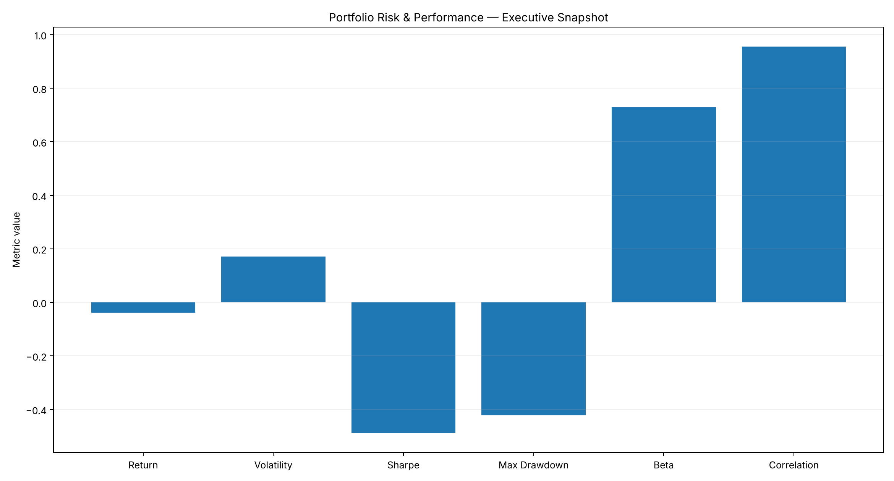
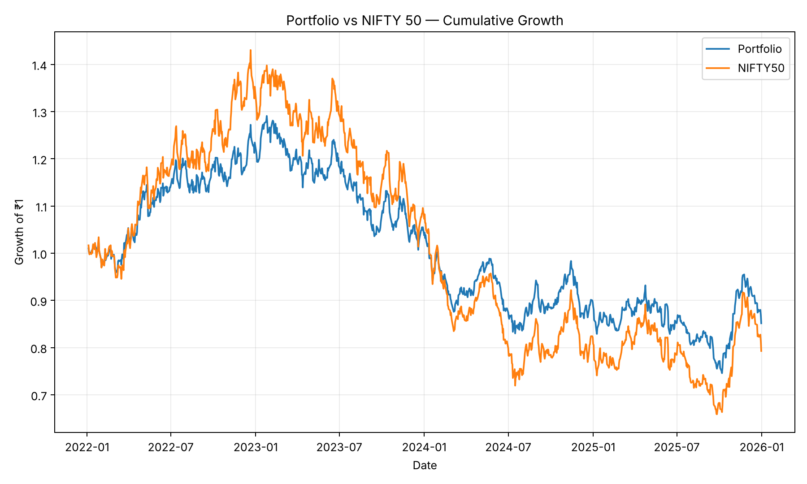
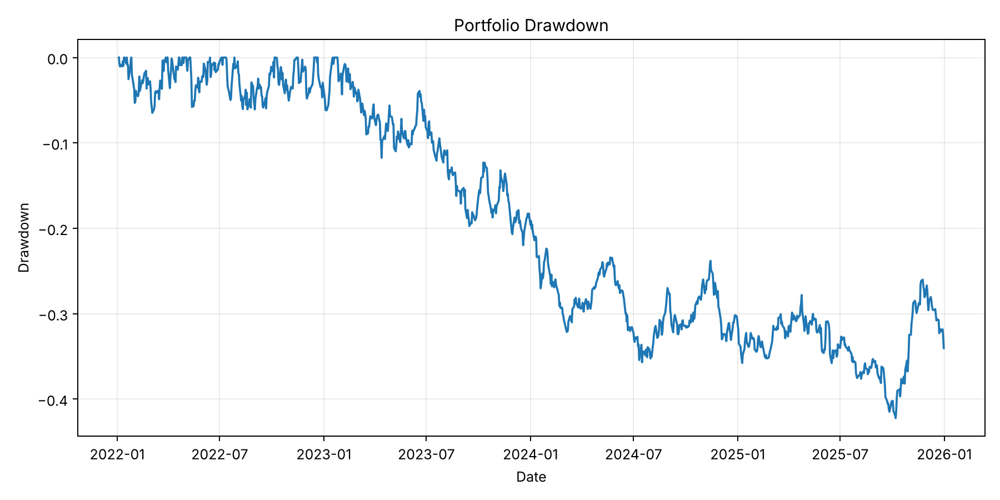
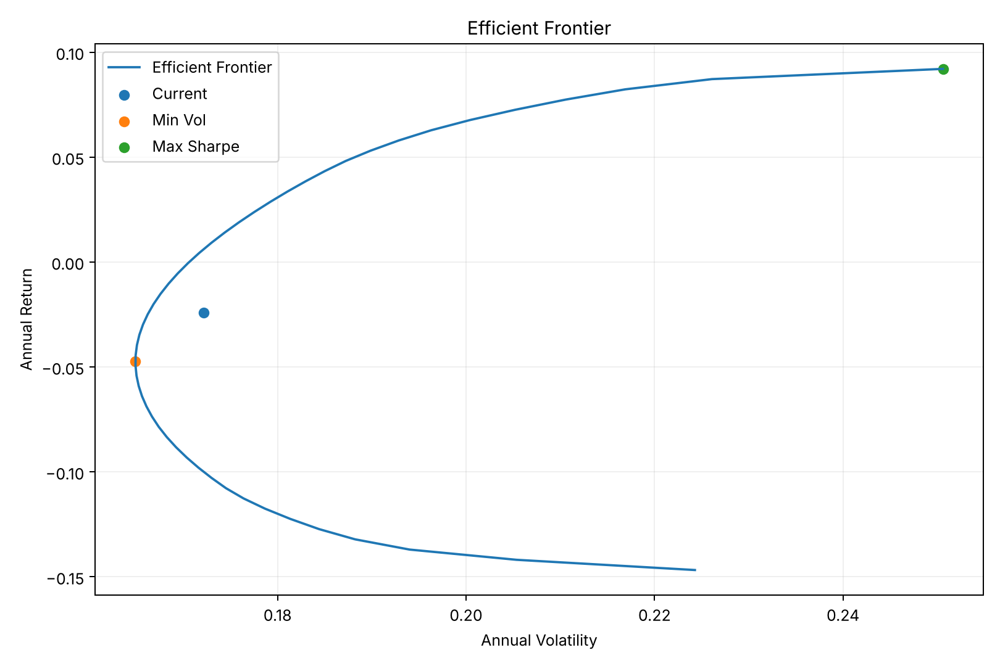
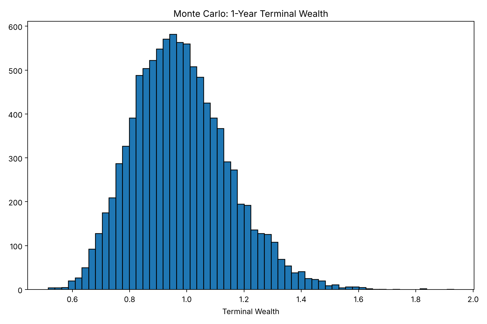

# Portfolio Risk & Performance Analytics

  

An end-to-end, reproducible risk and performance analysis of an **8-stock Indian equity portfolio vs the NIFTY 50**: performance, risk, attribution, optimization, Monte Carlo, stress tests, QA checks and executive reports, all generated from one command.

> ⚠️ **The bundled dataset is synthetic.** It demonstrates the pipeline; none of the numbers are real market results or investment advice.



## Key findings (synthetic data, 2022-01-03 → 2025-12-31, 1,042 trading days)

| Metric | Portfolio | Note |
|---|---|---|
| Annualized return (CAGR) | **-3.81%** | NIFTY 50 (synthetic) CAGR: -5.46% |
| Annualized volatility | **17.21%** | |
| Sharpe / Sortino | **-0.49 / -0.67** | Risk-free rate 6% |
| Max drawdown | **-42.23%** | |
| Daily 95% VaR / ES | **1.83% / 2.29%** | Historical method |
| Beta / correlation to NIFTY | **0.73 / 0.96** | Highly market-driven |
| Jensen alpha | **-1.81%** | |

**What the analysis shows**

1. **Weak risk-adjusted return.** The portfolio beat the synthetic benchmark in absolute terms but still returned less than the 6% risk-free rate.
2. **Diversification is limited.** Eight stocks, but 0.96 correlation to the index. Stock count alone is not diversification.
3. **Risk is spread unevenly.** LT is the largest risk contributor (18.4% of volatility) at a 15% weight.
4. **The unconstrained optimizer is a warning, not a recommendation.** Max-Sharpe puts ~100% in Bharti Airtel because it chases noisy historical mean returns. A 30% position cap gives a more defensible result (return 5.43%, volatility 19.99%, Sharpe -0.03), though it still holds 90% in three names.
5. **Monte Carlo (10,000 one-year paths):** 58.3% probability of ending below starting wealth; 5th-percentile terminal wealth 0.73x.

## Quick start

```bash
git clone https://github.com/palakprabhat0304/Portfolio-Risk-Performance-Analytics.git
cd Portfolio-Risk-Performance-Analytics
pip install -r requirements.txt
python run_project.py          # regenerates everything in outputs/ (~1 min)
python -m unittest tests.test_smoke
```

You do **not** need to run anything to see the results: they are already in `outputs/` (charts, CSVs, Excel workbooks, PowerPoint, Markdown reports). Running the code only regenerates them, e.g. after you change weights in `src/config.py` or swap in your own price data.

## Where to look

| If you want... | Open |
|---|---|
| The one-page story | `outputs/EXECUTIVE_SUMMARY.md`, `outputs/DASHBOARD.png` |
| The decision/recommendation | `outputs/PORTFOLIO_RECOMMENDATION.md` |
| How metrics are calculated | `outputs/METHODOLOGY.md` |
| Detailed tables | `outputs/portfolio_risk_performance_report.xlsx` |
| Slides | `outputs/Portfolio_Risk_Analytics_Presentation.pptx` |
| Automated checks | `outputs/QA_REPORT.md`, `outputs/risk_flags.csv` |
| Design | `docs/ARCHITECTURE.md`, `docs/DATA_DICTIONARY.md` |

## Charts

| Cumulative performance | Drawdown |
|---|---|
|  |  |
| **Efficient frontier** | **Monte Carlo** |
|  |  |

## Methods in brief

Geometric CAGR, sample volatility × √252, Sharpe/Sortino, historical VaR and Expected Shortfall, CAPM beta and Jensen alpha, risk contribution, return attribution, long-only min-vol and max-Sharpe optimization (plus a 30%-capped version), efficient frontier, Monte Carlo (i.i.d. normal), beta-based stress tests, 63-day rolling volatility and beta. Full detail and limitations: [`outputs/METHODOLOGY.md`](outputs/METHODOLOGY.md).

## Limitations

- Synthetic data; no dividends, splits, taxes, costs or liquidity.
- Optimizer inputs are historical means (very noisy); results are in-sample only.
- Monte Carlo ignores fat tails and volatility clustering; stress tests are linear (beta × shock).

## Using real data

Replace `data/market_prices_demo.csv` with adjusted close prices (same columns), edit `src/config.py` if tickers or weights change, then rerun. Full checklist: [`docs/REAL_WORLD_CHECKLIST.md`](docs/REAL_WORLD_CHECKLIST.md).

## Project structure

See [`PROJECT_STRUCTURE.md`](PROJECT_STRUCTURE.md). Release notes: [`CHANGELOG.md`](CHANGELOG.md).
